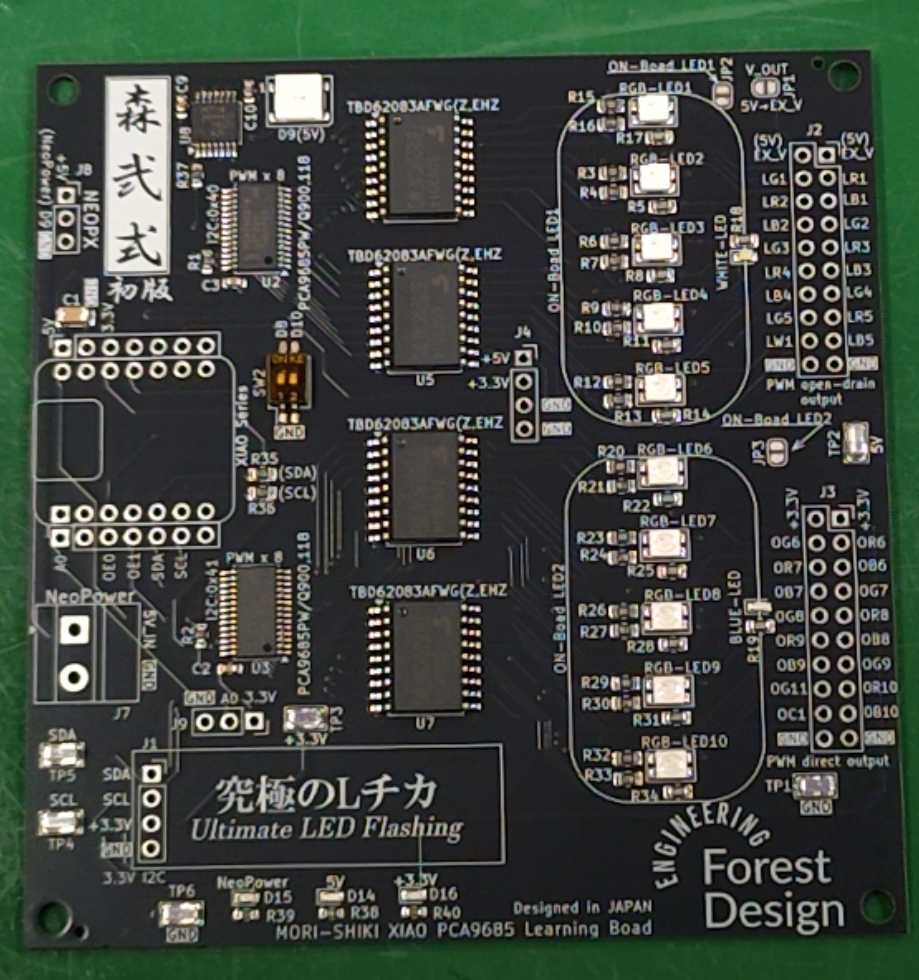
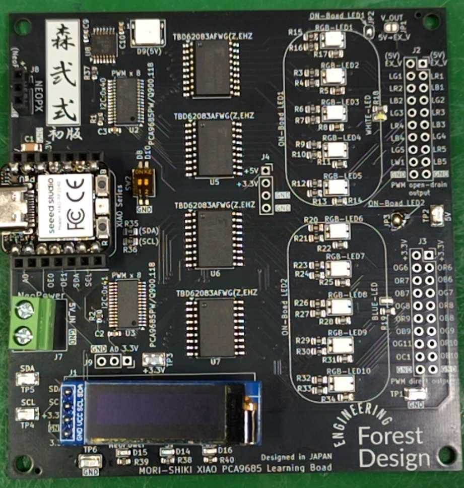
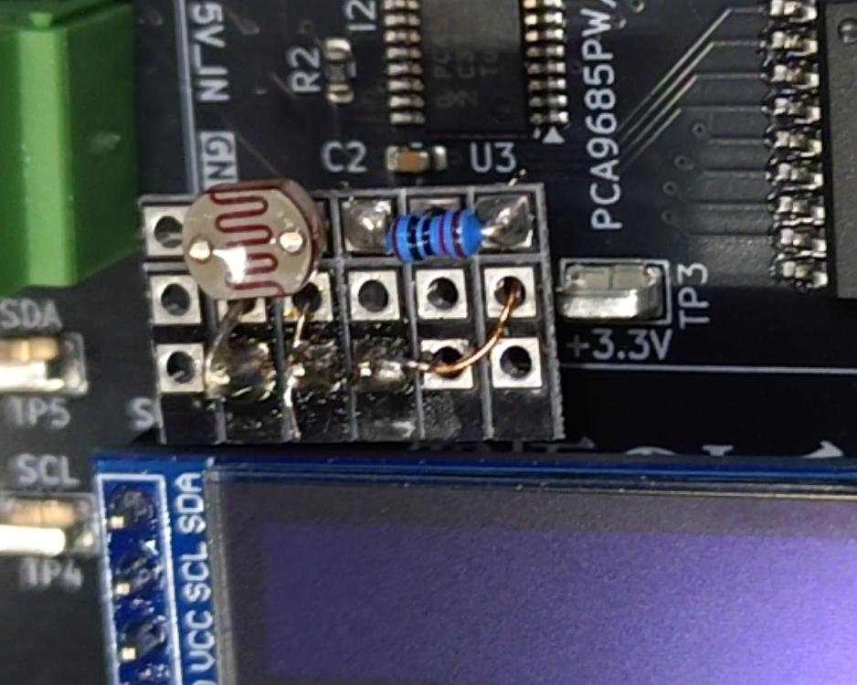

# ForestDesign-MORI-2
PCA9685 PWM / LED Control Learning Board

## XIAO + PCA9685 + NeoPixel「究極のLチカ」ボード

森弐式は、Seeed Studio XIAOシリーズをコントローラーとして使用し、PCA9685による多チャンネルPWM制御とNeoPixelを手軽に実験できるようにした開発・デモ用基板です。

PCA9685を2個搭載し、オンボードにはRGB LEDを10個、白色LED、シアンLEDを実装しています。

さらにPCA9685のPWM出力は外部コネクタにも引き出してあるため、オンボードLEDだけでなく、外部LEDやロボット用サーボなどのPWM制御にも利用できます。

NeoPixelもオンボードに1個搭載し、外部NeoPixel用コネクタも装備しています。外部5V電源を使用することで、NeoPixelバーやLEDテープなどを接続できます。

基板のシルクには「究極のLチカ / Ultimate LED Flashing」と入れました。

なお、その位置にはOLEDを装着できます。

**OLEDを装着すると「究極のLチカ」の文字が隠れます。仕様です🤣**
森弐式基板外観写真
 

---

# 1. 主な仕様

## コントローラー

Seeed Studio XIAOシリーズを装着して使用します。

初回動作確認では **XIAO RP2040** を使用しました。
以下のXIAOで動作確認済です。
- XIAO RP2040
- XIAO ESP32S3
- XIAO ESP32C3
- XIAO ESP32C6

森弐式側の信号名はMCU固有のGPIO番号ではなく、XIAOのArduinoピン名称（D2、D3、D4など）で統一しています。

これにより、内部GPIO番号の異なるXIAOへ変更する場合でも、森弐式側の端子機能を把握しやすくしています。

---

# 2. XIAOピン割り当て

| Arduinoピン | 用途            |
| --------- | ------------- |
| D2        | PCA9685-1 OE0 |
| D3        | PCA9685-2 OE1 |
| D4        | I2C SDA       |
| D5        | I2C SCL       |
| D8        | DIPスイッチ       |
| D9        | NeoPixel DATA |
| D10       | DIPスイッチ       |
| A0        | 外部アナログ入力      |

DIPスイッチはONするとGNDへ接続される構成です。

A0、3.3V、GNDは外部コネクタにも出してあり、ポテンショメーターや光センサーなどを接続した実験を想定しています。

---

# 3. I2Cデバイス

森弐式ではD4 / D5をI2Cバスとして使用しています。

| デバイス | I2Cアドレス |
| --- | ---: |
| SSD1306 OLED | 0x3C |
| PCA9685-1 | 0x40 |
| PCA9685-2 | 0x41 |

PCA9685-1はA0～A5をGNDとし、PCA9685-2はA0のみHigh、A1～A5をGNDとしてアドレスを分離しています。

実機のI2Cスキャンでは、`0x3C`、`0x40`、`0x41` の3デバイスを正常に検出しました。

---

# 4. PCA9685とオンボードRGB LED

## PCA9685-1（0x40）

| PCA9685 ch | 接続先 |
| ---: | --- |
| 0 | RGB1 R |
| 1 | RGB1 G |
| 2 | RGB1 B |
| 3 | RGB2 R |
| 4 | RGB2 G |
| 5 | RGB2 B |
| 6 | RGB3 R |
| 7 | RGB3 G |
| 8 | RGB3 B |
| 9 | RGB4 R |
| 10 | RGB4 G |
| 11 | RGB4 B |
| 12 | RGB5 R |
| 13 | RGB5 G |
| 14 | RGB5 B |
| 15 | White LED |

## PCA9685-2（0x41）

| PCA9685 ch | 接続先 |
| ---: | --- |
| 0 | RGB6 R |
| 1 | RGB6 G |
| 2 | RGB6 B |
| 3 | RGB7 R |
| 4 | RGB7 G |
| 5 | RGB7 B |
| 6 | RGB8 R |
| 7 | RGB8 G |
| 8 | RGB8 B |
| 9 | RGB9 R |
| 10 | RGB9 G |
| 11 | RGB9 B |
| 12 | RGB10 R |
| 13 | RGB10 G |
| 14 | RGB10 B |
| 15 | Cyan LED |

RGB LEDはR / G / Bをそれぞれ独立したPWMチャンネルで制御します。

---

# 5. RGB LED制御API

アプリケーション側からPCA9685のチャンネル配置や12bit PWM値を意識しなくてもよいように、RGB LEDを次の形式で制御しています。

`rgb_ctrl(LED番号, R, G, B)`

- LED番号：1～10
- R：0～255
- G：0～255
- B：0～255

内部では0～255のRGB値をPCA9685の12bit PWM値（0～4095）へ変換します。

これにより、NeoPixelに近い感覚で通常のRGB LEDを扱えます。

例：

- `rgb_ctrl(1, 255, 0, 0)` → RGB1を赤
- `rgb_ctrl(2, 0, 255, 0)` → RGB2を緑
- `rgb_ctrl(3, 0, 0, 255)` → RGB3を青
- `rgb_ctrl(4, 255, 128, 0)` → RGB4をオレンジ
- `rgb_ctrl(5, 0, 0, 0)` → RGB5を消灯

White LEDおよびCyan LEDも、0～255の256階調で扱う簡易関数を使用できます。

- `White_LED(level)`
- `CYAN_LED(level)`

---

# 6. NeoPixel

森弐式にはNeoPixelを1個オンボード搭載しています。

DATAはD9です。

さらに外部NeoPixel用コネクタを備えており、外部5Vを供給することでNeoPixelバーやLEDテープなどを接続できます。

動作確認ではオンボードNeoPixel 1個に加え、8LEDのNeoPixelバーを接続し、**合計9個のNeoPixel**を正常に制御できました。

NeoPixelについても明るさを抑えた状態で、赤 → 緑 → 青 → 白の基本発光、および虹色グラデーション表示を確認しています。

---

# 7. 外部5V電源

NeoPixelなど外部負荷用として外部5V入力を備えています。

外部5Vが供給されると、専用の赤色LEDが点灯して電源状態を確認できます。

基板上にはさらに、5V（VBUS）の青LED、3.3Vの緑LEDの電源確認LEDを搭載しています。

---

# 8. OLED

SSD1306 128×32 や 128x64 I2C OLEDを装着できます。

I2Cアドレスは `0x3C` で動作確認済みです。

初回テストではOLEDに次の内容を表示しました。

- MORI-II TEST
- OLED : 0x3C OK
- PCA1 : 0x40 OK
- PCA2 : 0x41 OK

PCのシリアルモニターを使用しなくても、センサー値、動作モード、設定値などを基板単独で確認する表示装置として利用できます。

※OLEDを装着すると「究極のLチカ」のシルクが隠れます。
OLED等装着した森弐式写真

---

# 9. DIPスイッチ

2点DIPスイッチを実装しています。

- D10
- D8

に接続しており、ON時にGNDへ接続されます。

`INPUT_PULLUP`で読み取ることで、2bit＝4種類の動作モード選択などに利用できます。

| DIP | モード例 |
| --- | --- |
| 00 | ナイトライダー |
| 01 | RGBグラデーション |
| 10 | NeoPixelレインボー |
| 11 | 究極のLチカ・全部盛り |

---

# 10. A0アナログ入力

A0、3.3V、GNDを外部へ出しています。

10kΩ程度のポテンショメーターを接続すれば、LED全体の明るさ、エフェクト速度、色相、グラデーション速度などをリアルタイムに操作できます。

Cdsセルによる光量調整による効果を確認済。

アナログピンソケットにCdsセンサーを取り付けた状態

---
# 11.外部拡張用コネクタ
- **右上 2×10コネクタ：外部LED駆動用**  
    外部LEDを接続して駆動可能。LED用電源は、**森弐式ボード上の5V**を使用するか、**外部電源**を使用するかを、ボード上のソルダージャンパーで選択できる。
    
- **右下 2×10コネクタ：PCA9685 PWM出力**  
    PCA9685のPWM信号がダイレクトに引き出されている。外部拡張基板などと組み合わせることで、**ロボット用サーボなどへPWM制御信号を供給**できる。
---

# 12. デモプログラム

## RGB順次点灯

RGB1～RGB10を順番に、赤 → 緑 → 青で点灯します。

PCA9685-1 ch15のWhite LEDおよびPCA9685-2 ch15のCyan LEDも単独点灯できます。

## RGBグラデーション

通常のRGB LED×10をPCA9685のPWMで制御し、LEDごとに位相をずらした色相・輝度グラデーションを表示します。

PCA9685の12bit PWMを内部で使用しながら、アプリケーション側では8bit RGBとして扱います。

## ナイトライダー風エフェクト

RGB1～RGB10を光点が往復します。

中心LEDを明るく、その後方を1/3、1/8程度の輝度にすることで残光を表現しています。

1往復ごとに、赤 → オレンジ → 黄 → 緑 → シアン → 青 → 紫 → マゼンタと色を変更します。

## NeoPixelグラデーション

オンボードNeoPixel＋外部8LEDバーの合計9個へ、それぞれ位相をずらしたレインボーグラデーションを表示します。

PCA9685によるナイトライダー表示とNeoPixelグラデーションを同時動作させることで、異なるLED制御方式を同一基板上で比較できます。

---

# 13. 初回動作確認結果

初版基板のオンボード機能について、次の項目を確認しました。

- 5V VBUS確認LED：OK
- 3.3V確認LED：OK
- 外部5V確認LED：OK
- XIAO RP2040起動：OK
- I2C：OK
- SSD1306 OLED：OK
- PCA9685-1（0x40）：OK
- PCA9685-2（0x41）：OK
- OE0 / OE1：OK
- RGB LED 1～10：R / G / BすべてOK
- White LED：OK
- Cyan LED：OK
- オンボードNeoPixel：OK
- 外部8LED NeoPixelバー：OK

**初版基板のオンボード機能はパターン修正なしで動作確認できました。**

外部PWM出力については別途評価予定です。

---

# 14. 基板製造

回路図、PCBレイアウト、Gerber、BOM、CPLはKiCadを使用して作成しました。

PCB製造および部品実装はJLCPCBへ依頼しました。

ソルダーレジストは黒色を選択しています。

---

# 15. 森弐式の設計コンセプト

森弐式の出発点は、PCA9685を実験するためのボードです。

市販のPCA9685ボードでも実験はできますが、それだけではすぐに飽きそうだったため、PWMの効果を目で見て遊べるよう、オンボードにRGB LED×10、White LED、Cyan LEDを搭載しました。

さらに開発途中でNeoPixelを追加し、PCA9685で通常のRGB LEDを制御する方式と、NeoPixelによるアドレサブルLED制御を同じ基板上で比較できる構成としました。

NeoPixelは外部にも接続できるため、LEDバーやLEDテープを使用したデコレーションにも応用できます。

PCA9685のPWM出力はオンボードLEDだけで完結させず外部にも引き出しています。拡張基板などを組み合わせることで、外部LEDやロボット用サーボなどのPWM制御実験へ発展できます。

普通のRGB LEDをPCA9685で制御し、`rgb_ctrl(LED番号, R, G, B)` というNeoPixelに近いAPIで扱うことで、グラデーションや残光などのLEDエフェクトも簡単に記述できます。

**「究極のLチカ」は入口。遊びながらPWMを理解し、そのまま外部制御へ発展できるボードを目指しています。**

#16. 森弐式回路図

